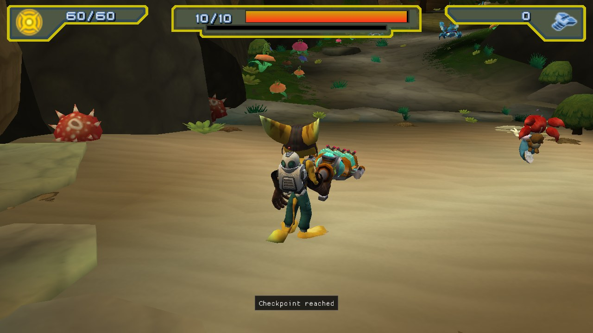
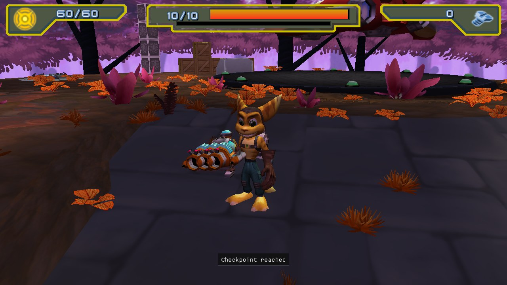
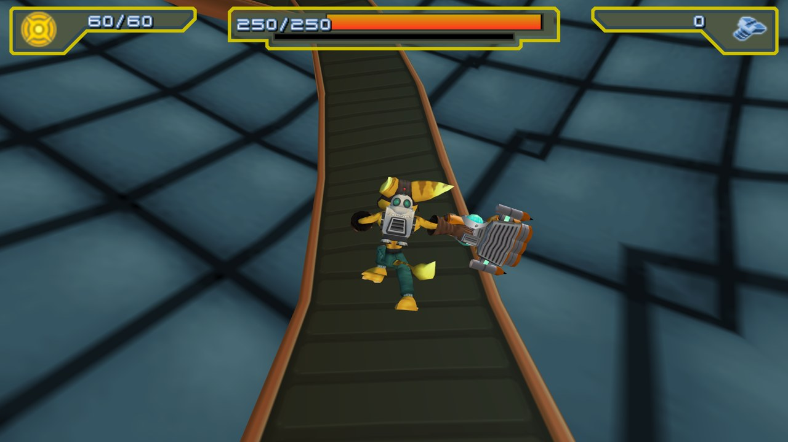
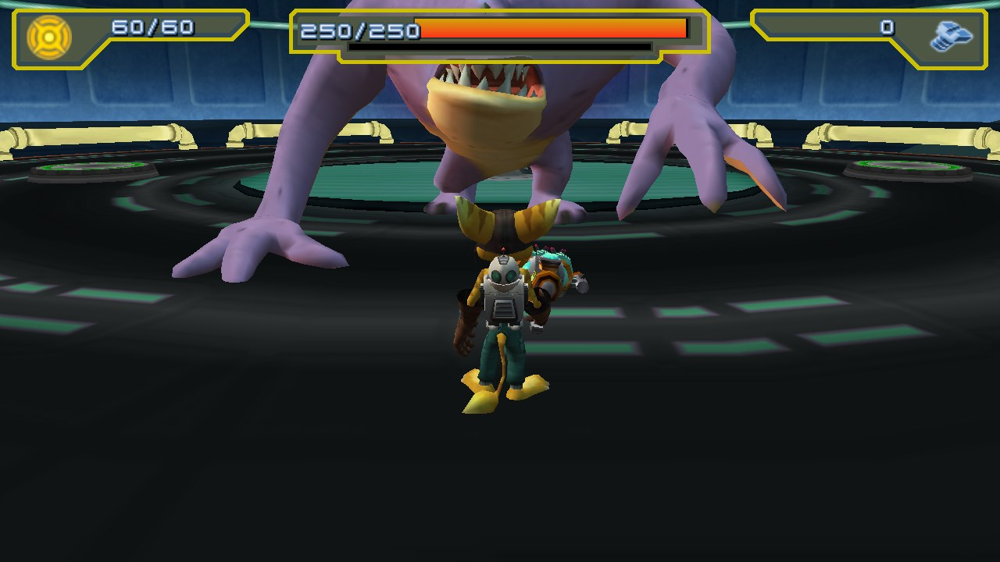
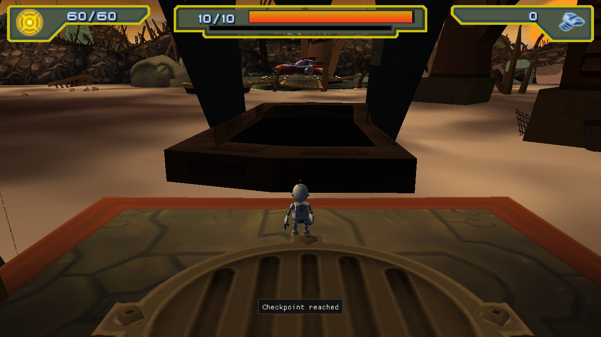
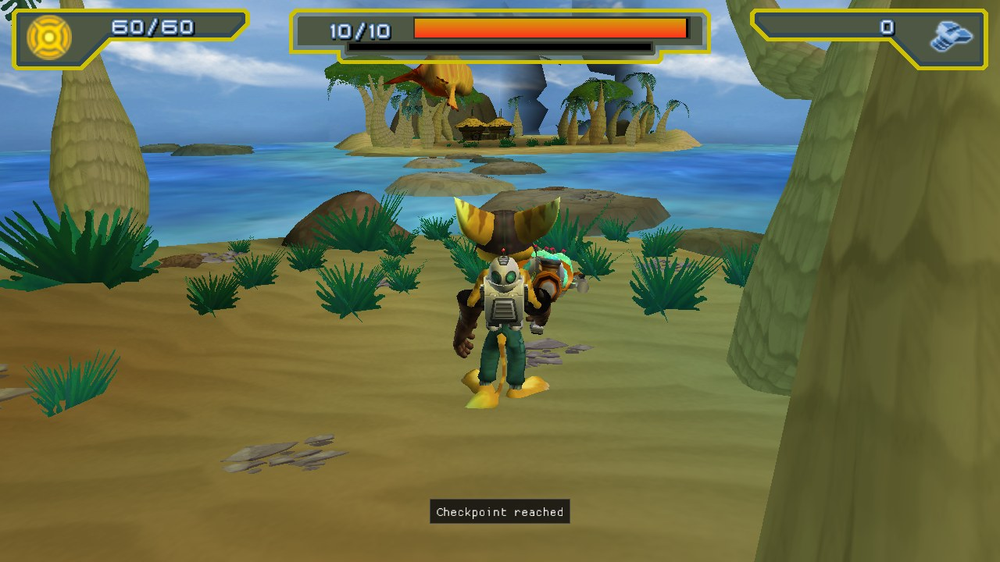

<div align="center">

# sm_pc

**A native PC engine for _Ratchet & Clank: Size Matters_ (PlayStation 2, USA)**

It reads your own disc image directly and runs the game with its own code: no emulator, and nothing of the
original program is executed.

[](LICENSE)


 
 
 

</div>

---

## What this is

`sm_pc` is a from-scratch engine that plays *Size Matters* from the data on the original disc: levels, models,
animation, collision, HUD, text, sounds, music and movies are all read from your ISO at run time. The game's
behaviour is rebuilt natively, class by class, from a study of the original (addresses of what each piece was read
from are in the source comments and in [`docs/`](docs/SIZE_MATTERS_CAMPAIGN.md)).

**No game data is in this repository or in its releases.** You need your own copy of the game.

## Status

This is a work in progress. What is built is proven by hidden, scripted play-throughs (see
[Checking a build](#checking-a-build)); what is not built is said plainly, here and in the ledger.

| Level | State |
| --- | --- |
| 01 Pokitaru | Playable: movement, combat, the wrench and blaster, enemies, crates and bolts, vendor, swimming, the zipline, checkpoints, the level's movies and its exit. |
| 02 Ryllus | End to end: both of Ratchet's halves, the Sprout-O-Matic chain, the Hypershot, and Clank's temple with its gadgebots, to the last movie. |
| 03 Kalidon | End to end, landing pad to end movie: both Grind Locks, the shaft set piece, the fluid lake, the hook hall, the magnet room on the Magneboots, the junk conveyor, and the boss. Mungo is a first version (his first phase's moves through all four phases); the magnet room's bombs and the skyboard race are not built. |
| 04 Metalis | The story's way through: Clank in the arena's lobby, the crane, the growth pad. The arena's three games (Destruction Derby, Microbot Toss, Microbot Survival) are not built. |
| 05 Dreamtime and later, Giant Clank | They load and draw. Not yet playable end to end. |

Also in: every weapon and gadget with its own model, shots, sounds and effects (some fidelity gaps are listed in
the ledger), the seven armor sets and their powers, the original HUD, a pause menu rebuilt in the game's own plates
with PC graphics options, a photo mode, screenshots and video recording, keyboard / mouse and XInput pads.

The full account - what was read, what is built, what is native guesswork and what is missing - is
[`docs/SIZE_MATTERS_CAMPAIGN.md`](docs/SIZE_MATTERS_CAMPAIGN.md).

## Getting started

### You need

- Windows 10 or 11 (x64) with a Direct3D 11 graphics card
- Your own disc image of **Ratchet & Clank: Size Matters, USA (SCUS-97615)**, as an `.iso`
- Optional: [FFmpeg](https://ffmpeg.org/) on your `PATH`, for the game's movies (without it they are skipped)
- Optional: an XInput controller

### Run

Download `sm_pc.exe` from the [latest release](../../releases/latest) and start it with your disc image:

```bat
sm_pc.exe "C:\Games\Ratchet & Clank - Size Matters (USA).iso"
```

Start a level directly with `--level` (`/WAD/01.WAD` Pokitaru, `/WAD/02.WAD` Ryllus, `/WAD/03.WAD` Kalidon,
`/WAD/04.WAD` Metalis, ...):

```bat
sm_pc.exe "C:\Games\Ratchet & Clank - Size Matters (USA).iso" --level /WAD/03.WAD --width 1920 --height 1080
```

### Controls

| | Controller | Keyboard / mouse |
| --- | --- | --- |
| Move | Left stick | `W` `A` `S` `D` |
| Camera | Right stick | Mouse |
| Jump, glide | `A` | `Space` |
| Fire | `B` | `E` |
| Wrench | `X` | `F` |
| Next weapon, interact | `Y` | `R` |
| Strafe | `LT` | `Z` |
| Crouch (high / long jump with jump) | `RB` | `C` |
| Help desk | `Back` | `Tab` |
| Pause | `Start` | `Esc` |
| Options window | | `F1` |
| Record video / capture settings / screenshot | | `F9` / `F11` / `F12` |

### Useful options

| Option | What it does |
| --- | --- |
| `--level /WAD/NN.WAD` | Start in a level instead of the title screen |
| `--width W --height H --fps N` | Window size and frame cap |
| `--all-weapons`, `--all-armor` | Start with every weapon and gadget / every armor piece |
| `--hero-skin N` | One of the game's own seven skins (0 is the default Ratchet) |
| `--player-position x,y,z` | Start somewhere else in the level |
| `--photo` | Open the photo mode |
| `--record FILE.mp4` | Record video (Media Foundation H.264 / AAC) |
| `--mute` | No sound |

Run `sm_pc.exe` with no arguments for the full list, including the scripted-play options the tests use.

## Building from source

You need Visual Studio 2022 or newer (Desktop development with C++) and CMake 3.24 or newer. Dear ImGui is fetched
by CMake; everything else is in the repository.

```bat
git clone https://github.com/Quasar30-dev/sm_pc.git
cd sm_pc
cmake -S . -B build -A x64
cmake --build build --config Release
build\Release\sm_pc.exe "C:\Games\Ratchet & Clank - Size Matters (USA).iso"
```

### Layout

| Path | What is there |
| --- | --- |
| `src/sm/` | The game: gameplay, enemies, the levels' own classes (`classes_level02.cpp` ...), weapons, armor, HUD, pause menu, renderer (Direct3D 11), audio, movies |
| `src/hig/` | Readers for the disc's formats: the ISO and its WADs, levels, collision, actors and animation, HUD, text, sound |
| `src/media/` | Screenshots and video capture |
| `compat/` | Stand-in headers for an engine this repository does not carry (see below) |
| `third_party/` | A subset of meshoptimizer |
| `docs/` | The ledger of what was read from the original and what is built |
| `tools/sm/` | The scripted level runs and the reading tools |

### Checking a build

Each level that is claimed to work has a script that plays it in a hidden, muted window and checks its milestones:

```bat
set SM_PC_EXE=build\Release\sm_pc.exe
set SM_PC_ISO=C:\Games\Ratchet & Clank - Size Matters (USA).iso
python tools\sm\sm_ryllus_run.py
python tools\sm\sm_kalidon_run.py
python tools\sm\sm_metalis_run.py
```

Each prints `PASS` or `FAIL` per milestone, names its log, and says which testing aids it used (for example a
health boost in the fights). They need Python 3 with Pillow.

## What is not in this repository

`sm_pc` is developed inside a larger private project, where it can also borrow from the other PS2 *Ratchet & Clank*
games' discs - their Ratchets, weapons, packs and wrenches, a follow camera, and diving under water. Those options
are built on an engine that is not published, so this repository builds without them (`SM_PC_STANDALONE`, see
[`src/sm/extras.h`](src/sm/extras.h)): their classes are present as empty shells
([`src/sm/extras_absent.cpp`](src/sm/extras_absent.cpp)) and the menus do not offer them. Everything that is
*Size Matters* itself is here. The docs sometimes refer to tools and files of that project that are not included.

## Legal

`sm_pc` is an independent, non-commercial fan project. It is not affiliated with, endorsed by or connected to Sony
Interactive Entertainment, Insomniac Games or High Impact Games. *Ratchet & Clank* and *Size Matters* are
trademarks of their owners. This repository contains no game code, no game assets and no keys; the engine only
reads a disc image you supply. The screenshots above show the game's own art as drawn by the engine.

## License

Copyright (C) 2026 the sm_pc authors.

`sm_pc` is free software: you can redistribute it and modify it under the terms of the
[GNU General Public License, version 3](LICENSE), as published by the Free Software Foundation. It is distributed
in the hope that it will be useful, but WITHOUT ANY WARRANTY; without even the implied warranty of MERCHANTABILITY
or FITNESS FOR A PARTICULAR PURPOSE.

Third-party code and its licenses are listed in [`THIRD_PARTY.md`](THIRD_PARTY.md).
